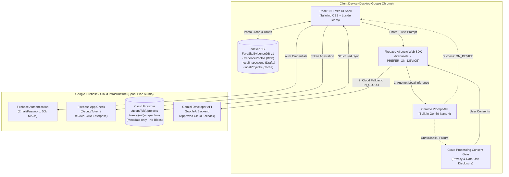

# ForeSite — Master Reference Specification

**Document Version:** 2.0.0  
**Last Updated:** November 16, 2026  
**Project:** ForeSite (BuildHybridAI 2026 Hackathon)  
**Primary Target Platform:** Web (Desktop Google Chrome)  
**Repository Target:** `https://github.com/oxmoriarty/foresite.git`  
**Current Phase:** Phase 4: Hybrid AI Integration (Authorized by Project Owner; NOT Started)

---

## 1. Project Overview and Purpose

**ForeSite** is a professional, Chrome-first, AI-assisted construction site inspection and observation workspace developed for the **BuildHybridAI 2026 Hackathon**.

The core mission of ForeSite is to dramatically reduce the clerical burden of field site inspections by transforming captured photographs and inspectors' preliminary notes into structured observation drafts. 

ForeSite is built around two immutable core philosophies:
1. **Local-First Evidence Protection:** Original high-resolution photographs are preserved locally on the capturing device in client-side IndexedDB by default. Image binaries and Base64 strings are **never** stored in or transmitted to Cloud Firestore documents.
2. **Mandatory Human-in-the-Loop Oversight:** AI is treated strictly as an authoring assistant for preliminary drafts (`draft_generated`). Under no circumstances does the application make autonomous safety determinations, evaluate structural compliance, or certify regulatory code adherence. Every inspection record requires qualified human review, editing, and sign-off (`approved` or `rejected`).

---

## 2. Current Approved Product Requirements

- **Field Project Management:** Create, read, update, and delete construction inspection projects (name, description, client name, project address, status).
- **Inspection Recording:** Create and update inspections attached to projects with category selection (Structural, Electrical, Plumbing, HVAC, Fire Safety, General, Environmental, Finishes), field observation notes, visible evidence lists, uncertainties, and follow-ups.
- **Evidence Photo Management:** Attach original site photographs (JPEG, PNG, WebP $\le$10 MB), validate format and size client-side, manage memory with automatic object URL revocation, display full-resolution modals, and support local deletion with cascade cleanup on project deletion.
- **Local Draft Persistence:** Debounced (1500 ms) auto-save and explicit manual save to IndexedDB to preserve drafts across browser reloads within the same browser profile.
- **Hybrid AI Drafting (Phase 4):** Combine attached photograph evidence and inspector notes to generate structured inspection drafts using Firebase AI Logic hybrid inference, preferring Chrome's on-device Gemini Nano 4 model and falling back to cloud inference under approved conditions.
- **Human Review Actions:** Strict lifecycle management (`draft_generated` $\rightarrow$ `in_review` $\rightarrow$ `approved` / `rejected`), recording reviewer UID and timestamp.
- **Cloud Metadata Synchronization (Phase 5):** Synchronize lightweight structured inspection metadata and project data to Cloud Firestore under owner-scoped path security.

---

## 3. Approved System Architecture

---

## 4. Approved Technology Stack

| Layer | Selected Technology | Version / Configuration | Purpose & Rationale |
| :--- | :--- | :--- | :--- |
| **Framework & Build** | React 19 + TypeScript | Vite 6.x, strict TypeScript mode | Fast HMR, type-safe domain logic, zero boilerplate |
| **Styling & UI** | Tailwind CSS + Lucide React | PostCSS, accessible contrast | Clean, utility-first styling with accessible icon landmarks |
| **Local Storage** | Browser IndexedDB | Native IndexedDB API (`ForeSiteEvidenceDB`, v1) | Stores raw binary `Blob` objects and unsynced drafts with zero cloud cost |
| **Authentication** | Firebase Authentication | `firebase/auth` (v12.5.0+) | Secure email/password authentication, tenant isolation (`uid`) |
| **Structured Database**| Cloud Firestore | `firebase/firestore` (v12.5.0+) | Real-time JSON metadata sync, owner-scoped security rules |
| **AI Hybrid Engine** | Firebase AI Logic | `firebase/ai` (v12.5.0+) | Hybrid on-device/cloud generative inference routing |
| **Local AI Engine** | Chrome Prompt API | Built-in Gemini Nano (Chrome Desktop 139+) | Desktop Chrome native on-device inference |
| **App Attestation** | Firebase App Check | `firebase/app-check` (v12.5.0+) | Protects backend APIs; debug token for dev, reCAPTCHA Enterprise for prod |
| **Testing** | Vitest + React Testing Library | Vitest 3.x, `fake-indexeddb` | Unit and integration testing with fake IndexedDB environment |
| **Hosting (Planned)** | Firebase Hosting | Free Spark tier static deployment | Fast global CDN distribution for static Vite bundle |

---

## 5. AI Model and Hybrid Inference Decisions

The project owner has explicitly approved the Phase 0 Hybrid AI API design across six key decision areas:

### Decision Area A: Hybrid AI Architecture and Gemini Nano Integration
- **Hackathon Alignment:** ForeSite implements the hackathon-required Gemini Nano on-device inference capability through Firebase AI Logic (`firebase/ai`).
- **Runtime Version Transparency:** Official Chrome documentation establishes that Chrome's Prompt API uses Gemini Nano. The exact model version as "Gemini Nano 4" is an unverified specification requirement from hackathon materials, which cannot be definitively established from runtime reflection. The application integrates via Firebase AI Logic without bypassing it.
- **Routing Configuration:** Configured using `mode: InferenceMode.PREFER_ON_DEVICE` (when automatic fallback is ON) or `mode: InferenceMode.ONLY_ON_DEVICE` (when automatic fallback is OFF).
- **Model Management:** Chrome's supported Prompt API integration manages the on-device Gemini Nano model.
- **Naming Invariant:** Developers must **never** pass `"gemini-nano-4"` or `"gemini-nano"` as a model string to `getGenerativeModel()`. Passing a local model name will cause cloud fallback to fail with `UNKNOWN_MODEL`. The model string parameter controls the cloud fallback target exclusively.
- **Multimodal Support:** Photo and text analysis are supported as a single-turn prompt combining text instructions with a base64 inline image part (`image/jpeg`, `image/png`).
- **Inference Source Reporting:** The UI displays `ON_DEVICE` or `IN_CLOUD` **strictly** when verified by official SDK metadata (`result.response.inferenceSource`). If the source cannot be conclusively established, the UI reports `UNKNOWN`. Source must never be inferred from latency, browser version, or network status.

### Decision Area B: Cloud Fallback Model
- **Fallback Trigger Conditions:** Cloud inference is an approved fallback **only** when all of the following conditions are met:
  1. On-device inference is unavailable, still downloading, or cannot execute on the current browser/device.
  2. The client workstation is online.
  3. The user has given explicit consent (either via persistent setting or per-request modal).
  4. The selected Firebase AI Logic configuration and model support the intended workflow.
  5. Applicable free-tier quota and service restrictions permit the request without billing.
- **Approved Cloud Fallback Model:** `gemini-3.5-flash-lite`.
- **Verification Confirmation:** Official Firebase documentation identifies `gemini-3.5-flash-lite` as a supported, stable model and the default cloud-hosted fallback model starting with Firebase JS SDK v13.0.0. It supports multimodal (photo + text) inputs and structured JSON output.
- **Substitution Invariant:** No model substitution (e.g. to `gemini-2.5-flash-lite`) is permitted unless a specific, documented compatibility issue justifies that decision and the project owner explicitly approves it.

### Decision Area C: Firebase App Check
- **Enforcement:** App Check enforcement remains enabled to protect cloud endpoints and the Gemini Developer API from unauthorized abuse.
- **Development Configuration:** Registered Firebase App Check debug tokens (`FIREBASE_APPCHECK_DEBUG_TOKEN`) may be used during local development. Debug tokens must **never** be committed to version control or included in production builds.
- **Production Configuration:** Production deployments must use an officially supported provider (e.g., `ReCaptchaEnterpriseProvider`).
- **Integrity Rule:** App Check enforcement must never be weakened or disabled to bypass implementation difficulties.

### Decision Area D: Quota Management and Cooldowns
- **Dynamic Limits:** Quota availability is provider- and project-dependent. Quotas are not treated as permanent or unlimited, and historical RPM/RPD limits are not hardcoded.
- **Graceful Degradation:** When free-tier rate limits or Firestore quotas are reached, ForeSite presents a controlled user-facing cooldown message respecting actual provider responses. Do not assume `Retry-After` is always exposed by Firebase AI Logic; use a valid retry delay if exposed by the SDK, otherwise apply a conservative temporary cooldown.
- **Zero Automatic Retry:** Never automatically retry a failed cloud request.
- **Zero Billing:** Under no circumstances will billing be upgraded or paid services activated to circumvent quota limits.
- **Manual Continuity:** The manual inspection creation, editing, and photo review workflow must remain 100% operational when AI inference is unavailable or throttled.

### Decision Area E: Privacy, AI Processing Transmission, and Firestore Synchronization
- **Architectural Distinction:** ForeSite clearly distinguishes **AI processing transmission** from **ordinary application synchronization**:
  1. **AI Processing Transmission:** Governs transmission of inspection photographs and notes to Google's Gemini Developer API for AI-assisted draft generation. Discloses that under Google's Developer API free-tier terms, content submitted to the API (including inspection photographs and notes) may be processed by Google and used to improve Google products and services (`https://ai.google.dev/gemini-api/docs/pricing`).
  2. **Ordinary Application Synchronization:** ForeSite's established architecture continues to synchronize structured inspection records, including observations, visible evidence, identifiers, timestamps and metadata, to Cloud Firestore under `/users/{uid}/inspections/{id}`. Original photo binaries remain in IndexedDB and are not uploaded to Firestore.
- **Decline Path Behavior:** When automatic fallback is OFF and an inspector declines cloud AI processing:
  - Photographs and notes are **never** transmitted to the Gemini Developer API for inference.
  - The declined cloud inference request is **never** automatically retried.
  - Original photographs are preserved in IndexedDB.
  - The inspector continues authoring manually.
  - Ordinary Firestore synchronization of structured inspection records, including observations and notes, continues according to existing application behavior and security rules.
  - The application does **not** falsely claim that all inspection information remains solely on the device.
- **Disabling Invariant:** Disabling automatic cloud fallback must never disable on-device AI.

### Decision Area F: Hardware & Browser Compatibility
- **Decoupled Architecture:** ForeSite is architected for standard supported desktop environments and must **not** be designed around any specific personal computer's disk space, memory, or GPU limitations.
- **Documented Prerequisites:** Chrome Desktop 139+ with `#prompt-api-for-gemini-nano-multimodal-input` and `#optimization-guide-on-device-model` flags enabled; sufficient GPU/VRAM or CPU/RAM resources.
- **Verification Standard:** Never claim Gemini Nano has been executed on a device without direct runtime evidence.

### Decision Area G: User-Controlled Automatic Cloud Fallback Setting & Two-Mode Inference Architecture
- **Setting Location:** ForeSite provides a persistent setting under **Settings → AI & Privacy → Automatic cloud fallback**.
- **Default State:** Strictly **OFF** for all new users, unauthenticated preview sessions, and failed reads.
- **Model Initialization Sequencing:** On-device model initialization via `model.initializeDeviceModel()`. In Mode A (`PREFER_ON_DEVICE`), initialization is triggered after user interaction with non-blocking rejection handling (`.catch(...)`) without awaiting download completion before submitting inference, allowing cloud routing while downloading. In Mode B (`ONLY_ON_DEVICE`), initialization is awaited with progress feedback, and inference is submitted strictly after download completes. No shared helper forces Mode A to await download.
- **State-Based Preference Contract:** Implements `CloudFallbackPreference` (`enabled`, `source: "firestore"|"local"|"default"`, `syncStatus: "synced"|"pending"|"failed"|"unavailable"`). Key: `foresite_pref_auto_cloud_fallback_${uid}`. Inference blocked while resolution is pending. Safe default OFF on read failure, sign-out, or invalid state. In-flight requests capture an immutable preference snapshot. Nested profile updates preserve existing user profile fields. Existing Firestore security rules restrict read/write to the authenticated owner.
- **Enforceable Payload Safeguards:** Strict 4 MB ceiling enforced on encoded AI derivatives before inference, with dynamic reduction or controlled rejection. Original Blobs remain untouched in IndexedDB.
- **Mode A (Setting ON — Automatic Cloud Fallback):**
  - Uses `mode: InferenceMode.PREFER_ON_DEVICE`.
  - Attempts on-device Gemini Nano inference first; automatically falls back to Google Cloud (`gemini-3.5-flash-lite`) if on-device inference is unready, downloading, or unavailable.
  - Pre-authorized by user: no separate modal prompt for each inspection. Clear disclosure provided in Settings regarding cloud transmission and free-tier data-use terms.
- **Mode B (Setting OFF — Consent-Controlled Cloud Fallback - Default):**
  - Uses `mode: InferenceMode.ONLY_ON_DEVICE` for initial attempt.
  - On-device AI executes whenever available.
  - If on-device inference cannot complete (distinguishing active downloading from genuine failure), the system halts and presents an explicit Cloud Processing Consent modal before transmitting data.
  - If accepted, dispatches a secondary request with `mode: InferenceMode.ONLY_IN_CLOUD`.
  - If declined, data is never transmitted to the Gemini Developer API, and user returns to manual drafting while ordinary Firestore metadata sync continues.
- **Explicit Fallback & Error Classification:**
  - Distinguishes model unavailability, downloading state, unsupported inputs, local execution crashes, cloud network failure, and HTTP 429 quota exhaustion.
  - Never implements independent cloud retry when automatic fallback is OFF.
  - A declined request is never retried automatically.
- **Account Isolation & Persistence:**
  - Local preference keys are strictly namespaced by authenticated UID: `foresite_pref_auto_cloud_fallback_${uid}`.
  - Sign-out clears/detaches the active user scope in memory and resets runtime state to safe default OFF.
  - Account switching loads the incoming UID's namespaced local cache and reconciles with Firestore `/users/{uid}.preferences.autoCloudFallback`.
  - Unauthenticated preview sessions use safe default OFF.
  - Firestore write failures are caught and surfaced; unsaved changes are not falsely indicated as synchronized.
  - Requests capture an immutable scoped snapshot of the preference at click-time; in-flight requests are never mutated mid-execution.
  - Disabling automatic cloud fallback never disables on-device AI.

---

## 6. Data Storage and Synchronization Strategy

| Storage Layer | Medium | Data Stored | Privacy & Cost Invariants |
| :--- | :--- | :--- | :--- |
| **IndexedDB (`ForeSiteEvidenceDB`, v1)** | Client Browser Disk | Original high-res photo Blobs (`evidencePhotos`), local drafts (`localInspections`), cached project descriptors (`localProjects`) | Original photo binaries remain in browser IndexedDB. ForeSite does not upload them to Firestore or cloud storage. Disclosed as local-only storage. |
| **Cloud Firestore** | Firebase Cloud | Structured project records (`/users/{uid}/projects/{id}`) and inspection records (`/users/{uid}/inspections/{id}`) | Structured inspection records, including observations, visible evidence, identifiers, timestamps and metadata. Original photo binaries remain in IndexedDB and are not uploaded to Firestore. |
| **Firebase Storage** | *Excluded* | None | **Strictly prohibited** to avoid billing requirements and stay within the Spark plan. |
| **Supabase Storage** | *Excluded from MVP* | None | Assessed as feasible with Edge Functions in Phase 0 research, but explicitly excluded from core implementation to maintain zero-cost local architecture. |

---

## 7. Authentication, Security, and Privacy Requirements

1. **Authentication Provider:** Firebase Authentication using Email and Password. Provides unique `user.uid` for tenant scoping.
2. **Owner-Scoped Firestore Security Rules:**
   - Strict deny-by-default top-level rule: `match /{document=**} { allow read, write: if false; }`.
   - Projects and inspections reside under `/users/{uid}/...` subcollections.
   - Operations require `request.auth.uid == uid` and `request.resource.data.ownerUid == request.auth.uid`.
   - Update operations require `request.resource.data.ownerUid == resource.data.ownerUid` to prevent document ownership hijacking.
3. **App Check:** Enforces that only authorized ForeSite web application clients can access Firestore and backend endpoints.
4. **Local Data Disclosure:** Prominent banners inform the user:
   > *"Inspection photos are stored locally on this computer only. They are not uploaded to cloud storage or accessible from other browsers/devices. Clearing browser data will remove local photos."*
5. **No Binary Leakage:** Strict linting and testing ensure no Base64 strings or Blobs are ever written to Firestore document fields.

---

## 8. Non-Negotiable Cost and Billing Restrictions

ForeSite is governed by an absolute **Zero-Cost / No-Billing Policy**:
- **Firebase Plan:** Firebase Spark Plan ($0.00/month) exclusively.
- **No Credit Card:** No credit card, billing account, or payment method is attached to the Firebase project.
- **No Blaze Upgrade:** Upgrading to the Blaze plan is strictly forbidden.
- **Hard Quota Stop:** If Firestore daily limits (50,000 reads/day, 20,000 writes/day) or Gemini Developer API limits (1,500 RPD) are reached, the application catches quota exceptions gracefully and stops without incurring financial charges.
- **Prohibited Services:**
  - Firebase Storage (requires Blaze for production scale or triggers billing).
  - Firebase Cloud Functions (requires Blaze plan).
  - Direct paid third-party AI APIs.

---

## 9. Human-in-the-Loop Requirements

AI-generated observations are **preliminary suggestions only**:
1. **Initial Review State:** Any inspection generated or assisted by AI enters the `draft_generated` review status.
2. **Mandatory Human Sign-Off:** The inspection must be transitioned by an authenticated human inspector to `in_review`, and subsequently to either `approved` or `rejected`.
3. **Audit Trail:** Transitioning to `approved` or `rejected` records the inspector's `reviewedByUid` and `reviewedAt` timestamp.
4. **Safety Boundaries:** The AI model is strictly prohibited by prompt and system instructions from:
   - Certifying structural safety or building code compliance.
   - Declaring a site definitively safe or unsafe.
   - Estimating physical dimensions, structural load, or hidden defects.
   - Overriding human review or altering review statuses autonomously.

---

## 10. Phase Completion and Implementation Status

| Phase | Title | Status | Git Commit / Deliverables |
| :--- | :--- | :--- | :--- |
| **Phase 0** | Discovery & Technical Verification | **APPROVED** | Starter pack specifications, zero-cost feasibility, API design approved across 6 decision areas (A–F). |
| **Phase 1** | Application Scaffolding & Foundation | **IMPLEMENTED & VERIFIED** | Commit `0bd4a7d` — Vite + React 19 + TypeScript, Tailwind CSS, UI components, navigation, domain types, unit tests. |
| **Phase 2** | Firebase Foundation & Authentication | **IMPLEMENTED & VERIFIED** | Commit `dbac94b` — Firebase Auth, `AuthModal`, owner-scoped `firestore.rules`, Firestore services, unit tests. |
| **Phase 3** | Local Evidence & IndexedDB Management | **IMPLEMENTED & VERIFIED** | Commit `05c3b59` — `ForeSiteEvidenceDB` v1, `PhotoEvidenceManager`, `InspectionEditorModal`, photo validation ($\le$10 MB), auto-save drafts, cascade deletion, 58/58 tests passing. |
| **Phase 4** | Hybrid AI Integration | **AUTHORIZED (NOT STARTED)** | Firebase AI Logic hybrid inference, Gemini Nano 4 on-device, cloud fallback, runtime output validation, consent flow. |
| **Phase 5** | Human Review & Cloud Synchronization | **PENDING** | Review lifecycle (`draft_generated` $\rightarrow$ `approved`), Firestore structured sync, offline resilience. |
| **Phase 6** | Production Hardening & Demo Preparation | **PENDING** | End-to-end audit, accessibility verification, hosted deployment, video demo recording. |
| **Phase 7** | Android Feasibility Assessment | **PENDING** | Post-MVP research report on mobile Gemini Nano 4 and native SDK feasibility. |

---

## 11. Current Development Phase and Next Authorized Phase

- **Current State:** Phase 3 has been fully implemented, tested, verified, and pushed to GitHub (`https://github.com/oxmoriarty/foresite.git`).
- **Phase 0 Status:** The Phase 0 Hybrid AI API design has been **explicitly approved** by the project owner across Decision Areas A through F.
- **Next Authorized Phase:** **Phase 4 (Hybrid AI Integration)** has been authorized by the project owner. However, implementation will **NOT** begin during this documentation task; it requires a separate explicit instruction.

---

## 12. Master Index of Reference Documents

All reference documents reside within `ForeSite_Antigravity_Starter_Pack/`:

| Document | Relative Path | Purpose |
| :--- | :--- | :--- |
| **Starter Guide** | [`ANTIGRAVITY_START_HERE.md`](./ANTIGRAVITY_START_HERE.md) | Entry checklist for Antigravity agents |
| **Agent Instructions** | [`AGENTS.md`](./AGENTS.md) | Strict behavioral and architectural rules for agents |
| **Product Brief** | [`docs/00_PRODUCT_BRIEF.md`](./docs/00_PRODUCT_BRIEF.md) | Problem statement, user personas, core workflows |
| **Hackathon Brief** | [`docs/01_HACKATHON_REQUIREMENTS.md`](./docs/01_HACKATHON_REQUIREMENTS.md) | Devpost competition criteria and constraints |
| **System Architecture**| [`docs/02_ARCHITECTURE.md`](./docs/02_ARCHITECTURE.md) | Architectural tiers, data boundaries, component model |
| **Hybrid AI Spec** | [`docs/03_HYBRID_AI_SPEC.md`](./docs/03_HYBRID_AI_SPEC.md) | Detailed Firebase AI Logic API, inference, and prompt specs |
| **Security & Privacy** | [`docs/04_DATA_SECURITY_PRIVACY.md`](./docs/04_DATA_SECURITY_PRIVACY.md) | Firestore rules, App Check, cloud consent, local storage |
| **UX & Testing** | [`docs/05_UX_TEST_DEPLOY.md`](./docs/05_UX_TEST_DEPLOY.md) | UI states, accessibility, testing requirements |
| **Decisions Register** | [`docs/DECISIONS.md`](./docs/DECISIONS.md) | Complete log of approved and proposed architectural decisions |
| **Build Plan** | [`docs/BUILD_PLAN.md`](./docs/BUILD_PLAN.md) | Phase-by-phase implementation roadmap |
| **No-Cost Policy** | [`docs/NO_COST_POLICY.md`](./docs/NO_COST_POLICY.md) | Non-negotiable Firebase Spark plan rules |
| **Source Register** | [`docs/SOURCE_REGISTER.md`](./docs/SOURCE_REGISTER.md) | Authoritative official documentation URLs |
| **Submission Checklist**| [`docs/SUBMISSION_CHECKLIST.md`](./docs/SUBMISSION_CHECKLIST.md) | Hackathon submission readiness gates |
| **Storage Research** | [`docs/SUPABASE_STORAGE_FEASIBILITY_REPORT.md`](./docs/SUPABASE_STORAGE_FEASIBILITY_REPORT.md) | Technical assessment of cross-device photo storage |
| **Phase 4 Prompt** | [`prompts/PHASE_4_HYBRID_AI.md`](./prompts/PHASE_4_HYBRID_AI.md) | Detailed prompt for Phase 4 execution |

---

## 13. Decision Status Register

This section tracks the explicit status of every key architectural capability:
- **Approved:** Formally accepted by the project owner; authorized for implementation.
- **Implemented:** Code authored in the active workspace.
- **Verified:** Fully covered by automated tests, typecheck, lint, and build.
- **Proposed:** Documented candidate design; requires official verification before code.
- **Blocked:** Prevented from proceeding by an unresolved technical or environmental barrier.
- **Deprecated:** Explicitly abandoned or replaced.

| Capability / Decision | Status | Detail & Constraints |
| :--- | :--- | :--- |
| **React 19 + Vite 6 + TypeScript Shell** | **VERIFIED** | Implemented in Phase 1; all tests pass; production bundle builds cleanly. |
| **Firebase Auth (Email/Password)** | **VERIFIED** | Implemented in Phase 2; modal UI, auth context, token persistence verified. |
| **Owner-Scoped Firestore Security Rules** | **VERIFIED** | Implemented in Phase 2; 16 automated security rules tests passing. |
| **IndexedDB Binary Photo Storage (`evidencePhotos`)** | **VERIFIED** | Implemented in Phase 3; native Blob storage, $\le$10 MB validation, URL revocation. |
| **Local Draft Persistence (`localInspections`)** | **VERIFIED** | Implemented in Phase 3; 1500 ms debounced auto-save, recovery across reloads. |
| **Project Cascade Deletion** | **VERIFIED** | Implemented in Phase 3; deleting a project purges linked local photos and drafts. |
| **Firebase AI Logic Web SDK (`firebase/ai`)** | **APPROVED** | Verified in Phase 0; imports `getAI`, `getGenerativeModel`, `GoogleAIBackend`. |
| **On-Device Routing (`InferenceMode.PREFER_ON_DEVICE`)** | **APPROVED** | Formally approved; delegates to Chrome Prompt API for Gemini Nano 4. |
| **Gemini Nano 4 as Model String** | **DEPRECATED** | Must not be passed as model string; Chrome Prompt API handles local selection. |
| **Proposed Cloud Fallback (`gemini-3.5-flash-lite`)** | **PROPOSED** | Approved candidate model; requires SDK version and availability verification. |
| **Cloud Fallback Consent Gate** | **APPROVED** | Mandatory explicit user consent before sending evidence to Google Cloud. |
| **App Check (Debug Token in Dev, reCAPTCHA in Prod)**| **APPROVED** | Mandatory attestation; debug tokens prohibited from version control. |
| **Quota Cooldowns & Graceful Throttling** | **APPROVED** | Responds to 429/quota limits with cooldown messages; never upgrades billing. |
| **Firebase Storage Integration** | **DEPRECATED** | Excluded by design to maintain strict zero-cost Spark plan compliance. |
| **Supabase Storage Integration** | **DEPRECATED (MVP)**| Researched in Phase 0; excluded from MVP to keep photos strictly local. |
| **Direct Gemini API Keys in Client** | **DEPRECATED** | Excluded for security and architecture compliance; Firebase AI Logic is sole path. |
