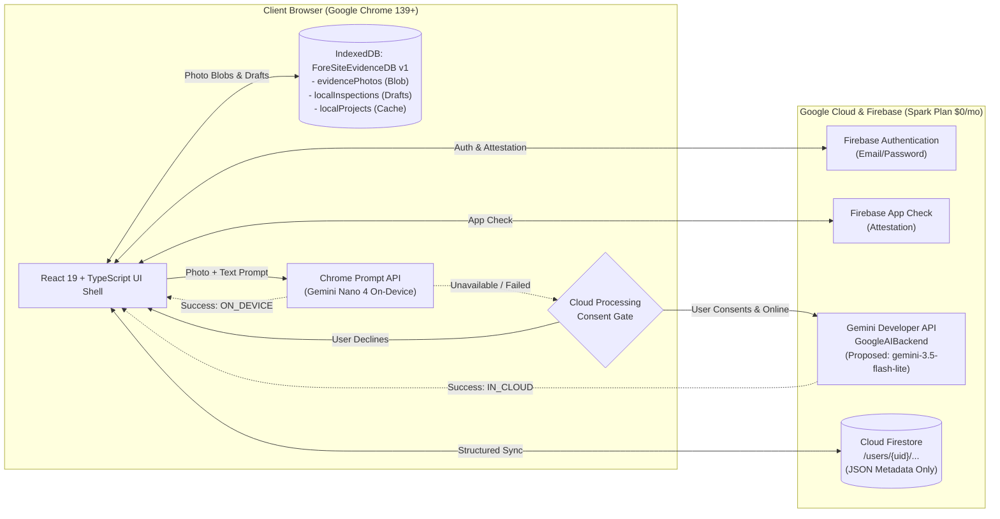

# ForeSite — System Architecture

**Document Version:** 2.0.0  
**Last Updated:** November 16, 2026  
**Status:** Approved & Synchronized with Phase 0 Decisions  
**Master Reference:** [`../FORESITE_MASTER_REFERENCE.md`](../FORESITE_MASTER_REFERENCE.md)

---

## 1. Architectural Overview

ForeSite is structured as a client-centric web application built for Google Chrome, combining local-first evidence storage with Firebase cloud services and hybrid AI inference.

---

## 2. Core Architectural Components

### 2.1 User Interface & Client Layer
- **Framework:** React 19 with Vite 6 and strict TypeScript.
- **Styling:** Tailwind CSS with accessible color contrast and Lucide React icons.
- **State Management:** React hooks and context (`AuthContext`), keeping UI state reactive and lightweight.
- **Storage Metrics:** Live tracking of IndexedDB usage and quota via `navigator.storage.estimate()`.

### 2.2 Local Evidence Engine (IndexedDB)
- **Database:** `ForeSiteEvidenceDB` (Version 1).
- **Stores:**
  - `evidencePhotos`: Original high-resolution photo Blobs (JPEG, PNG, WebP $\le$10 MB). Indexed by `inspectionId`, `projectId`, `createdAt`.
  - `localInspections`: Working inspection drafts and offline records. Indexed by `projectId`, `lastSavedAt`, `isSynced`.
  - `localProjects`: Cached project metadata for offline continuity. Indexed by `updatedAt`.
- **Invariants:**
  - Original photograph binaries remain client-side only.
  - Image bytes and Base64 payloads are **never** stored in Cloud Firestore.
  - Deleting a project triggers cascade deletion of linked local drafts and photo Blobs.
  - UI prominently discloses that local photos reside on the device and will be removed if browser site data is cleared.

### 2.3 Hybrid AI Inference Engine
- **SDK:** Firebase AI Logic Web SDK (`firebase/ai`, v12.5.0+).
- **Backend Provider:** `GoogleAIBackend()` connecting to the Gemini Developer API (free tier on Firebase Spark plan).
- **Routing Strategy:** `InferenceMode.PREFER_ON_DEVICE`.
  - The SDK attempts execution on Chrome's built-in **Gemini Nano 4** model via the browser's Prompt API.
  - If on-device inference is supported and ready, inference executes locally and reports `ON_DEVICE`.
- **Model Naming Rule:** Developers must **never** pass `"gemini-nano-4"` or `"gemini-nano"` as the model parameter to `getGenerativeModel()`. Passing a local model name causes cloud fallback to fail with an `UNKNOWN_MODEL` error. Chrome's Prompt API manages the local model automatically; the `inCloudParams.model` parameter governs cloud fallback.
- **Cloud Fallback Requirements:**
  - Triggered only when on-device inference is unavailable, downloading, or unsupported.
  - Client must be online.
  - User must provide **explicit, affirmative consent** before any evidence is transmitted to Google Cloud.
  - Proposed cloud fallback model is `gemini-3.5-flash-lite` (subject to SDK version and free-tier eligibility verification).
- **Inference Source Transparency:** UI displays `ON_DEVICE` or `IN_CLOUD` **strictly** when confirmed by `result.response.inferenceSource`. If unconfirmed or ambiguous, the UI displays `UNKNOWN`. Source is never guessed from latency or network heuristics.

### 2.4 Cloud Authentication & Attestation
- **Authentication:** Firebase Authentication with email and password. Generates verified `user.uid` tokens for Firestore tenant isolation.
- **App Check:** Enforces application attestation. Uses `FIREBASE_APPCHECK_DEBUG_TOKEN` during local development (never committed to version control) and an official provider (e.g., `ReCaptchaEnterpriseProvider`) in production. Enforcement is never disabled or bypassed.

### 2.5 Structured Cloud Database (Cloud Firestore)
- **Tenant Scoping:** All documents reside under owner-isolated subcollections:
  - `/users/{uid}/projects/{projectId}`
  - `/users/{uid}/inspections/{inspectionId}`
- **Security Rules:** Deny-by-default top-level rule. Read, write, and delete operations require `request.auth.uid == uid`. Update operations require `request.resource.data.ownerUid == resource.data.ownerUid` to ensure ownership immutability.
- **Payload Constraint:** Metadata only (title, observation, category, visibleEvidence[], photoIds[], timestamps). Document sizes are approximately 1–2 KB.

---

## 3. Approved Decision Boundaries

1. **Hardware Independence:** ForeSite is architected for standard supported desktop environments (Chrome 139+) and is not restricted to or designed around any individual developer's personal machine limitations.
2. **Zero-Cost / No-Billing Policy:** 100% compliant with the Firebase Spark plan ($0/month, no credit card attached). No Firebase Storage, no Cloud Functions, no paid third-party APIs.
3. **Quota & Cooldown Handling:** When rate limits or quotas are hit, ForeSite presents clear, user-facing cooldown alerts. Manual inspection workflows remain 100% operational regardless of AI availability.
4. **Human Review Mandatory:** AI produces draft observations only (`draft_generated`). Qualified humans must review, edit, and approve (`approved` / `rejected`) all records. The system never makes autonomous safety or compliance determinations.
