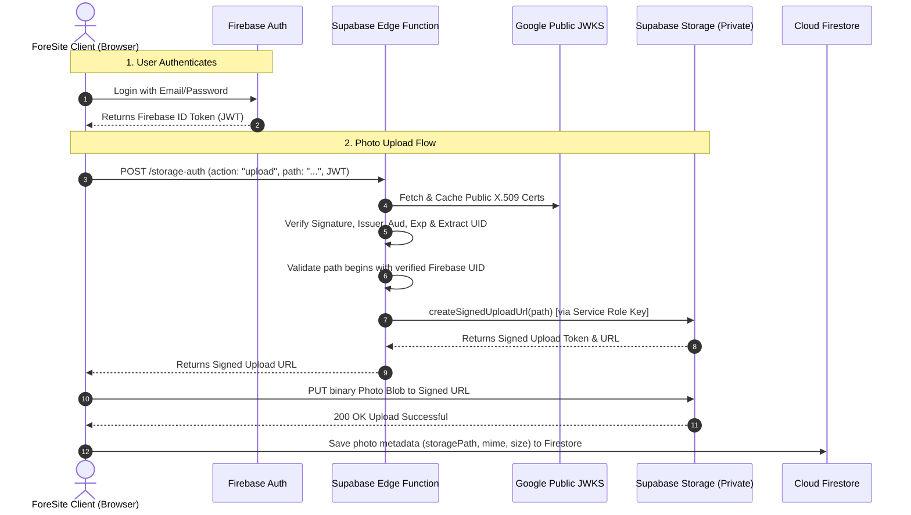

# ForeSite — Supabase Storage Feasibility & Technical Verification Report

**Document Version:** 1.0.0  
**Date of Research:** November 14, 2026  
**Status:** Research & Verification Complete (Read-Only)  
**Target Integration:** Supabase Storage as Cloud Evidence-File Provider for ForeSite  

---

## A. Executive Verdict

### **SUPABASE STORAGE IS SUITABLE WITH CONDITIONS**

Supabase Storage **can** be safely integrated into ForeSite as its cross-device cloud photograph and evidence-file storage provider while strictly adhering to our zero-cost, zero-billing policy. 

However, suitability is subject to **four non-negotiable architectural and operational conditions**:

1. **The Native Third-Party Auth Integration CANNOT be Used Directly:**  
   Supabase's built-in Third-Party Auth integration expects an explicit JWT custom claim (`role: 'authenticated'`). Because Firebase Auth cannot inject custom claims without the Firebase Admin SDK / Cloud Functions (which strictly requires the paid Firebase Blaze plan), direct client-side authentication to Supabase Storage is impossible under zero-billing constraints.
2. **A Supabase Edge Function Token Bridge is Mandatory:**  
   To authenticate Firebase users without paid services, ForeSite must deploy a lightweight, zero-cost Supabase Edge Function (`verify_jwt = false`). This function directly validates Firebase ID tokens against Google’s public cryptographic keys (`RS256`), extracts the verified Firebase UID, and mints time-limited, path-restricted signed upload and download URLs using the private Supabase service-role key.
3. **The 7-Day Inactivity Project Pause Must Be Managed:**  
   Free-tier Supabase projects automatically pause compute and storage access after 7 consecutive days without database activity. Stored files remain safe on disk, but live access is blocked until an administrator unpauses the project via the Supabase Dashboard.
4. **Capacity is Strictly Capped at 1 GB Storage / 5 GB Egress:**  
   The free tier accommodates approximately 340 high-resolution (3 MB) photos. This is more than adequate for a hackathon MVP and demonstration, but will require client-side photo optimization (~1 MB per photo) or a future tier upgrade for real-world commercial production scale.

---

## B. Verified Free-Tier Limits and Quotas

All metrics have been verified against current official Supabase documentation as of November 2026.

| Feature / Resource | Free Plan Quota | Enforcement Behavior | Cost / Card Requirement | Official Source Reference |
| :--- | :--- | :--- | :--- | :--- |
| **Account Creation** | Unlimited exploration | No card required | **100% Free / No Credit Card** | [Supabase Pricing](https://supabase.com/pricing) |
| **Active Projects** | Up to 2 active projects | Cap enforced | **$0** | [Supabase Free Tier Docs](https://supabase.com/docs/guides/platform/orgs-and-projects) |
| **File Storage Capacity** | **1 GB total** | Hard limit; further uploads blocked | **$0** (No overage billing possible) | [Supabase Storage Quotas](https://supabase.com/docs/guides/storage) |
| **Max Individual File Size** | **50 MB per file** | Upload rejected if exceeded | **$0** | [Supabase Storage Limits](https://supabase.com/docs/guides/storage/uploads/file-limits) |
| **Bandwidth (Egress)** | **5 GB per month** | Hard cap / 402 restriction after grace period | **$0** (No surprise charges) | [Supabase Fair Use Policy](https://supabase.com/docs/guides/platform/exhaust-resource-limits) |
| **Edge Function Invocations** | **500,000 / month** | Hard cap | **$0** | [Supabase Edge Functions Pricing](https://supabase.com/docs/guides/functions/pricing) |
| **Edge Function Memory** | **256 MB RAM** | Worker recycled if exceeded | **$0** | [Supabase Function Limits](https://supabase.com/docs/guides/functions/limits) |
| **Edge Function CPU Wall Time** | **150s timeout / 2s CPU** | Request terminated | **$0** | [Supabase Function Limits](https://supabase.com/docs/guides/functions/limits) |
| **Private Buckets & Signed URLs** | Included | Fully supported | **$0** | [Supabase Signed URLs](https://supabase.com/docs/guides/storage/security/signed-urls) |
| **Inactivity Policy** | **Pauses after 7 days** | Compute & Storage paused; data retained | **Free to unpause via Dashboard** | [Supabase Pausing Policy](https://supabase.com/docs/guides/platform/pausing) |

---

## C. Firebase Authentication Integration & The JWT Custom-Claim Problem

### 1. The JWT Custom-Claim Problem Explained
In Supabase's documented "Third-Party Auth" integration, Supabase directly consumes external JWTs and verifies them against the third-party issuer. However, Supabase Postgres Row Level Security (RLS) and storage authorization policies natively check the SQL context:
```sql
auth.role() = 'authenticated'
```
Firebase Authentication ID tokens (issued by `securetoken.google.com`) contain standard OpenID Connect claims (`sub`, `aud`, `iss`, `auth_time`, `email`), but **do not contain `role: 'authenticated'` by default**.

### 2. Can the Custom Claim Be Added Without Cloud Functions?
**No.**  
In Firebase Authentication, custom claims can only be set programmatically using the privileged Firebase Admin SDK via `admin.auth().setCustomUserClaims(uid, { role: 'authenticated' })`. 
- Clients cannot set or alter their own claims for security reasons.
- Running Firebase Cloud Functions or Identity Platform blocking functions requires upgrading the Firebase project to the **pay-as-you-go Blaze plan**.
- **Conclusion:** Modifying Firebase tokens to satisfy native Supabase Third-Party Auth is **impossible** under our zero-cost, no-Blaze constraint.

### 3. The Supported Solution: Supabase Edge Function Token Bridge
Rather than forcing Supabase Storage to parse the Firebase JWT directly via RLS, ForeSite can use a **Supabase Edge Function** as a secure, zero-cost authorization bridge.

Supabase Edge Functions run on the Deno runtime, are included on the Free plan (500,000 invocations/month), and require zero billing setup.

#### Verification of Key Capabilities:
1. **Google Public Key Verification:** Google publishes its active public signing certificates at:
   `https://www.googleapis.com/service_accounts/v1/metadata/x509/securetoken@system.gserviceaccount.com`
   The Edge Function can fetch and cache these certificates in-memory respecting the HTTP `cache-control: max-age` header (~1 hour).
2. **Cryptographic Validation via `jose`:** Using the standard library `jose` (available in Deno via `https://deno.land/x/jose` or `npm:jose`), the function validates:
   - Algorithm is `RS256`.
   - Key ID (`kid`) exists in Google's certificate bundle.
   - `iss == "https://securetoken.google.com/<FIREBASE_PROJECT_ID>"`.
   - `aud == "<FIREBASE_PROJECT_ID>"`.
   - Expiration (`exp`) has not passed.
   - Subject (`sub`) is a valid string.
3. **Immutable Identity Extraction:** `payload.sub` extracts the authentic, un-spoofable Firebase UID.
4. **Gateway Bypass:** The function is deployed with `verify_jwt = false` in `supabase/config.toml` so the Supabase API gateway does not reject the incoming Firebase bearer token before it reaches our custom verification code.
5. **Signed URL Generation:** The Edge Function initializes an internal Supabase admin client using the protected environment secret `SUPABASE_SERVICE_ROLE_KEY`:
   - **Upload authorization:** Calls `supabaseAdmin.storage.from('photos').createSignedUploadUrl(path)`.
   - **Download authorization:** Calls `supabaseAdmin.storage.from('photos').createSignedUrl(path, 60)` (valid for 60 seconds).
   - **Deletion:** Calls `supabaseAdmin.storage.from('photos').remove([path])`.



---

## D. Security Assessment & Threat Modeling

| Threat / Risk Vector | Severity | Vulnerability Description | Enforced Mitigation in Proposed Architecture |
| :--- | :--- | :--- | :--- |
| **Path Traversal / Cross-User Access** | **Critical** | A malicious user attempts to upload or read another user's photos by passing `../` or another user's UID. | The Edge Function **strictly derives the root path from `payload.sub`**. Any user-requested path is checked: `if (!path.startsWith(`${verifiedUid}/`)) throw new Forbidden()`. Subpaths are regex-validated against UUIDv4 patterns. |
| **User Identity Spoofing** | **Critical** | A client sends a forged `firebaseUid` parameter in the request body. | **The Edge Function ignores client-supplied UIDs.** Identity is derived exclusively from the cryptographically verified `sub` claim in Google's RS256 token. |
| **Credential / Secret Exposure** | **Critical** | Supabase Service Role Key leaked in client-side frontend code. | **The service role key is NEVER exposed to the browser.** It resides solely as a server-side environment secret inside the Supabase Edge Function runtime. The browser only receives the public Supabase URL and ephemeral signed URLs. |
| **Bucket Public Exposure** | **High** | Files accidentally made public on the web. | The `evidencePhotos` bucket is created with `public: false`. Anonymous and direct unauthenticated HTTP access is blocked at the gateway. Only signed URLs can read objects. |
| **Replay / Stolen URL Attacks** | **Medium** | An eavesdropper intercepts a signed download URL. | Download URLs are minted with an ultra-short TTL (time-to-live) of **60 seconds**. After 60 seconds, the URL permanently expires. |
| **Malicious / Massive File Uploads** | **Medium** | An attacker attempts to flood storage with non-image files or massive binaries. | The Edge Function validates requested file extensions (`.jpg`, `.jpeg`, `.png`) and expected content size. Supabase Storage enforces bucket-level file size caps (50 MB) and MIME type whitelists. |

---

## E. Recommended ForeSite Architecture

### 1. Component Responsibilities

```
+-----------------------------------------------------------------------------+
|                                FORESITE CLIENT                              |
|   (React 19 + TypeScript + Vite + Tailwind CSS + Chrome Desktop / Mobile)   |
+-----------------------------------------------------------------------------+
       |                         |                           |
       | Identity (JWT)          | Structured JSON           | Binary Blobs (Local)
       v                         v                           v
+------------------+    +-------------------+    +----------------------------+
|  FIREBASE AUTH   |    |  CLOUD FIRESTORE  |    |         INDEXEDDB          |
|  - Email/Pass    |    |  - Projects       |    |  - Local Photo Blobs       |
|  - Token Refresh |    |  - Inspections    |    |  - Offline Upload Queue    |
|  - Identity (UID)|    |  - Photo Metadata |    |  - Fast Offline Cache      |
+------------------+    +-------------------+    +----------------------------+
       |                                                     ^
       | Bearer Firebase ID Token                            | Direct Binary
       v                                                     | Upload/Download
+------------------------------------+                       |
|   SUPABASE EDGE FUNCTION BRIDGE    |                       |
|   - Verifies Google RS256 Tokens   |                       |
|   - Extracts verified UID          |                       |
|   - Enforces Path Ownership        |                       |
|   - Generates Ephemeral Signed URLs|                       |
+------------------------------------+                       |
       |                                                     |
       | Service Role Authorization                          |
       v                                                     v
+-----------------------------------------------------------------------------+
|                        SUPABASE STORAGE (PRIVATE BUCKET)                    |
|                        - Evidence Photographs (JPEG, PNG)                   |
|                        - Scoped Paths: {uid}/{projectId}/{inspId}/{photoId} |
+-----------------------------------------------------------------------------+
```

### 2. Standardized Storage Path Convention
All objects in the private bucket `evidencePhotos` strictly follow this deterministic path convention:
```
{firebaseUid}/{projectId}/{inspectionId}/{photoId}.{extension}
```
*Example:*  
`k7J9mQ2xL8P1/proj_550e8400/insp_881b21aa/photo_992c34bb.jpg`

### 3. Firestore Metadata Document Structure
Original image binaries are **never** stored in Firestore. Instead, the inspection document in Firestore contains lightweight photo metadata:

```typescript
interface FirestorePhotoReference {
  id: string;               // UUIDv4
  storageProvider: "supabase" | "local_only";
  storagePath: string;      // "{uid}/{projectId}/{inspectionId}/{photoId}.jpg"
  fileName: string;         // "crack_south_wall.jpg"
  mimeType: "image/jpeg" | "image/png";
  fileSizeBytes: number;    // 3,145,728
  capturedAt: number;       // Unix epoch ms
  uploadedAt: number | null;// Null if pending offline upload
  originalWidth: number;
  originalHeight: number;
}
```

### 4. Cross-Device Synchronization Flow
1. **Device A (Field Inspector):**
   - Captures photo $\rightarrow$ immediately saved as raw `Blob` in local IndexedDB.
   - Status marked as `pending_upload`.
   - When online, requests signed upload URL from Edge Function $\rightarrow$ uploads to Supabase Storage.
   - Saves inspection record with `storagePath` to Firestore.
   - Updates local IndexedDB status to `synced`.
2. **Device B (Office Supervisor):**
   - Reads inspection record from Firestore.
   - Checks local IndexedDB for photo ID $\rightarrow$ misses (first time on this device).
   - Calls Supabase Edge Function with user's Firebase ID token requesting signed download URL for `storagePath`.
   - Edge Function verifies token, checks that path starts with user's UID, and returns a 60-second signed URL.
   - Device B renders the photo and caches the Blob in Device B's local IndexedDB for instant future re-reads.

---

## F. Storage Capacity and Usage Analysis

We evaluate realistic construction photograph payloads averaging **3 MB per photograph** (standard 12–24 MP smartphone/tablet JPEG).

### 1. Scenario Analysis (3 MB / Photo vs. 1 GB Free Storage Quota)

| Photograph Volume | Total Storage Consumed | % of 1 GB Storage Allowance | Feasibility on Supabase Free Plan |
| :--- | :--- | :--- | :--- |
| **100 Photographs** | **300 MB (0.30 GB)** | **29.3%** | **PASS:** Fully viable with 70% headroom remaining. |
| **500 Photographs** | **1,500 MB (1.50 GB)** | **146.5%** | **FAIL:** Exceeds free storage cap by 500 MB (uploads blocked). |
| **1,000 Photographs** | **3,000 MB (3.00 GB)** | **293.0%** | **FAIL:** Exceeds free cap by 2.0 GB. |
| **2,000 Photographs** | **6,000 MB (6.00 GB)** | **586.0%** | **FAIL:** Exceeds free cap by 5.0 GB. |

### 2. Exact Storage Boundary
$$\text{Max 3 MB Photos in Free Tier} = \frac{1,024 \text{ MB}}{3.0 \text{ MB}} \approx \mathbf{341 \text{ photographs}}$$

> [!TIP]
> If ForeSite implements a lossless or high-quality client-side compression step (e.g. 1600px max dimension, WebP or 85% JPEG quality) reducing average photo size from 3 MB to **1 MB**, the free tier capacity expands to **~1,024 photographs**.

### 3. Bandwidth (Egress) Consumption Analysis
- **Monthly Free Bandwidth Cap:** **5 GB (5,120 MB)**.
- Every photo download across devices consumes egress equal to its file size.
- If a project contains 200 photos ($\approx 600\text{ MB}$):
  - Downloading the photo set once on an office supervisor's laptop: consumes **600 MB** (11.7% of monthly egress).
  - Synchronizing across 5 team devices: consumes **3.0 GB** (58.6% of monthly egress).
  - Downloading the photo set 9 times in a single month will exhaust the entire 5 GB monthly egress quota.
- **Client-Side Mitigation:** Devices must aggressively cache downloaded Blobs in local IndexedDB so the same photograph is **never downloaded more than once per device**.

### 4. Hackathon MVP vs. Production Scale
- **For BuildHybridAI 2026 Hackathon:** The 1 GB storage and 5 GB egress quotas are **abundantly sufficient**. Demonstrating 5 projects with 20 inspections each (100 total photos = 300 MB storage) consumes less than 30% of the free limits.
- **For Production Growth:** The 1 GB cap is a hard limit. A production deployment with continuous multi-site inspections will require either moving older evidence to cold archives or upgrading to Supabase Pro ($25/month for 100 GB storage and 250 GB egress).

---

## G. Implementation Implications for Existing ForeSite Artifacts

*Note: In accordance with read-only instructions, no modifications have been made to existing files. These represent the exact changes that would be required if approved for Phase 1/Phase 2.*

1. **`docs/02_ARCHITECTURE.md`:**
   - Update architecture diagrams to include Supabase Storage as the cloud object provider alongside Firebase Auth and Firestore.
   - Document the Supabase Edge Function authorization gateway.
2. **`docs/04_DATA_SECURITY_PRIVACY.md`:**
   - Document multi-cloud security guarantees: Firebase manages identity and structured records; Supabase manages encrypted private binary files.
   - Add disclosure on signed URL lifecycles (60-second read TTL).
3. **`docs/BUILD_PLAN.md` & Phase Prompts:**
   - **Phase 1 (Scaffold):** Add `@supabase/supabase-js` to dependency requirements.
   - **Phase 3 (Local Evidence):** Add Supabase Edge Function source code (`supabase/functions/storage-auth/index.ts`) and configuration (`supabase/config.toml`).
   - **Phase 5 (Review & Sync):** Implement the dual-write sync mechanism (upload photo to signed URL $\rightarrow$ commit metadata to Firestore $\rightarrow$ mark IndexedDB synced).
4. **Environment Configuration (`.env.example`):**
   - Add `VITE_SUPABASE_URL=https://<project-ref>.supabase.co`
   - Add `VITE_SUPABASE_ANON_KEY=<public-anon-key>`
   - Document server-side Edge Function secrets: `FIREBASE_PROJECT_ID` and `SUPABASE_SERVICE_ROLE_KEY`.
5. **TypeScript Interfaces:**
   - Extend `LocalEvidencePhoto` with `storagePath`, `syncStatus: 'local_only' | 'pending_upload' | 'synced' | 'failed'`, and `remoteUrlExpiry`.

---

## H. Unresolved Questions & Proof-of-Concept Requirements

1. **Edge Function Cold-Start Latency:**  
   Google's public certificates must be fetched over HTTP on initial edge function worker boot. While subsequent invocations within the worker instance use cached in-memory keys, initial cold-start latency must be measured (expected: 150–350 ms).
2. **Handling 7-Day Inactivity During Hackathon Judging:**  
   If the hackathon project is left dormant for 7 days before judges test it, Supabase will auto-pause. A scheduled GitHub Action (or manual unpause check) should ping the database once every 5 days during the judging window to prevent auto-pausing.
3. **Upload Interruption on Mobile Network Transitions:**  
   If an inspector enters a dead zone mid-upload, the signed upload token remains valid for 2 hours. A runtime test is required to confirm whether Supabase's `uploadToSignedUrl` cleanly resumes or requires requesting a new token.

---

## I. Final Recommendation

### **Recommendation: Adopt Supabase Storage with the Edge Function Bridge**

We recommend proceeding with Supabase Storage as ForeSite's cloud evidence photo provider under the Edge Function architecture:

1. **Strict Cost Compliance:** Supabase requires **no credit card**, **no billing account**, and enforces hard caps with **zero risk of unexpected charges**.
2. **Preserves No-Blaze Firebase Policy:** By handling token verification inside a free Supabase Edge Function, we completely eliminate the need for Firebase Cloud Functions, keeping our Firebase project 100% on the Spark plan.
3. **True Cross-Device Capability:** Solves the core user limitation of IndexedDB-only storage, allowing an inspector to take photos in the field and a supervisor to immediately review them in the office.
4. **Strong Security Invariants:** Private buckets, verified cryptographic identity from Google, and 60-second signed URLs provide enterprise-grade access control.
5. **Hackathon Alignment:** The 1 GB storage and 500,000 Edge Function calls provide more than 3x the capacity needed for a full hackathon presentation and live judging.

*End of Report.*
