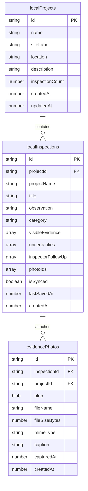

# ForeSite — IndexedDB Local Evidence Architecture & Specifications

This document outlines the architecture, data structures, and operational boundaries of the client-side **IndexedDB Local Evidence Storage Layer** implemented in **ForeSite** for the BuildHybridAI 2026 Hackathon.

---

## 1. Overview & Architectural Invariants

ForeSite is engineered with a strict **Local-First Evidence Principle**:
1. **Raw Photo Binary Retention:** Original photographic evidence Blobs remain stored locally in the browser's IndexedDB database.
2. **Zero-Cloud Binary Uploads:** Raw photo byte arrays, Blobs, or Base64 payloads are **never sent to Cloud Firestore**.
3. **Structured Cloud Sync:** Only high-level inspection metadata and photo descriptors (`id`, `fileName`, `fileSizeBytes`, `mimeType`, `capturedAt`) synchronize to Firestore.
4. **Resilient Local Drafts:** In-progress inspection notes, checklists, and attached photos persist across page reloads in the same browser profile.
5. **Zero-Cost / Spark Plan Compliance:** No Firebase Storage or paid cloud object stores are used.

---

## 2. Database Schema & Versioning

- **Database Name:** `ForeSiteEvidenceDB`
- **Database Version:** `1`
- **Upgrade Strategy:** Versioned schema management with declarative store creation and indexing in `onupgradeneeded`.

### Object Stores & Indexes



#### 1. Store: `evidencePhotos`
Stores the original image Blobs captured or selected by inspectors.
- **Primary Key:** `id` (string, e.g. `photo-1731754000-abcde`)
- **Indexes:**
  - `by_inspectionId` (`inspectionId`): Non-unique index for fast retrieval of all photos attached to an inspection.
  - `by_projectId` (`projectId`): Non-unique index for project-level evidence rollups and cascade deletions.
  - `by_createdAt` (`createdAt`): Non-unique index for chronological sorting.

#### 2. Store: `localInspections`
Stores unfinished inspection drafts, notes, and local checklist data.
- **Primary Key:** `id` (string, e.g. `insp-1731754000-fghij`)
- **Indexes:**
  - `by_projectId` (`projectId`): Non-unique index for project draft lookups.
  - `by_lastSavedAt` (`lastSavedAt`): Non-unique index for sorting drafts by newest edit.
  - `by_isSynced` (`isSynced`): Non-unique index to distinguish local-only drafts from published Firestore records.

#### 3. Store: `localProjects`
Stores local and offline project records for fast caching and offline creation.
- **Primary Key:** `id` (string, e.g. `proj-1731754000-klmno`)
- **Indexes:**
  - `by_updatedAt` (`updatedAt`): Non-unique index for recency ordering.

---

## 3. Photo Validation & Evidence Constraints

Site photograph intake is strictly validated client-side before any write transaction to IndexedDB:

| Constraint | Specification | Failure Handling |
| :--- | :--- | :--- |
| **Supported MIME Types** | `image/jpeg`, `image/png`, `image/webp` | Rejected with descriptive error (`Unsupported image format`) |
| **Allowed Extensions** | `.jpg`, `.jpeg`, `.png`, `.webp` | Rejected if extension does not match supported formats |
| **Maximum File Size** | **10 MB** (`10,485,760 bytes`) | Rejected with clear message indicating file size and limit |
| **Minimum File Size** | `> 0 bytes` | Rejected if 0-byte corrupted file |
| **Binary Representation** | Native Web `Blob` / `File` | Stored directly as Blob (never converted to Base64) |
| **Preview Management** | `URL.createObjectURL(blob)` | Revoked on unmount via `URL.revokeObjectURL(url)` |

---

## 4. Local Draft Persistence & Recovery Strategy

1. **Debounced Auto-Save:**
   - As an inspector enters notes, observation categories, physical evidence items, or follow-ups, changes are debounced (1500ms delay) and automatically committed to the `localInspections` store in IndexedDB.
   - The UI displays a live timestamp: *"Draft saved locally at [time]"*.
2. **Explicit Save:**
   - An explicit **"Save Draft"** button allows inspectors to force an immediate save without publishing.
3. **Session Recovery:**
   - On page reload or navigation to the **Inspections** screen, drafts are automatically queried from IndexedDB (`getAllLocalDrafts()`) and displayed with an amber **"Local Draft"** badge.
   - Clicking **"Continue Draft"** reopens the full editor with all observations, checklist items, uncertainties, and attached photo Blobs restored.
4. **Publish Transition:**
   - Clicking **"Save Inspection"** transitions the draft: structured data is synced to Firestore (when authenticated and online), while photographic Blobs remain preserved in local IndexedDB.

---

## 5. Storage Disclosure, Quota & Eviction Safeguards

### Mandatory User Disclosure
Because evidence photos are kept locally by default, ForeSite includes prominent warnings in the UI (in the inspection editor, photo manager, and settings screen):
- **Local-Only Boundary:** Photos remain on the current device and browser profile only.
- **No Cloud Backup:** Photos are not automatically synced to external cloud databases.
- **Cache Eviction Risk:** Clearing browser history, deleting site data, or deleting the Chrome user profile will permanently erase locally stored photographic evidence.
- **Offline Backup Recommendation:** Inspectors must retain external copies of critical evidence.

### Quota Monitoring & Error Handling
Implemented in `src/services/indexeddb.ts`:
- **`getStorageQuotaEstimate()`**: Uses `navigator.storage.estimate()` to inspect available device quota, used bytes, and calculate usage percentage.
- **`requestPersistentStorage()`**: Uses `navigator.storage.persist()` to request browser eviction protection for IndexedDB.
- **`ForeSiteStorageError`**: Custom error wrapper categorizing errors into:
  - `QUOTA_EXCEEDED`: User-friendly alert advising the inspector to free device disk space or remove older site photos.
  - `DB_BLOCKED`: Advises the user to close concurrent open tabs during schema upgrades.
  - `TRANSACTION_FAILED`: Transaction rollback notification.

---

## 6. Project Cascade Deletion

To prevent orphaned Blobs and storage leaks, deleting a project executes `deleteProjectCascade(projectId)`:
1. Queries all photos indexed under `projectId` and purges their Blobs from `evidencePhotos`.
2. Queries all drafts indexed under `projectId` and purges them from `localInspections`.
3. Purges the project from `localProjects`.
4. Deletes the project from Cloud Firestore (if authenticated).

---

## 7. Automated Test Suite

Run the dedicated IndexedDB and workflow test suites:

```bash
# Run IndexedDB and photo validation tests
npx vitest run tests/indexeddb.test.ts tests/photo-validation.test.ts

# Run inspection and project workflow tests
npx vitest run tests/inspection-workflows.test.tsx

# Run entire test suite (58 tests across 8 files)
npm test
```
